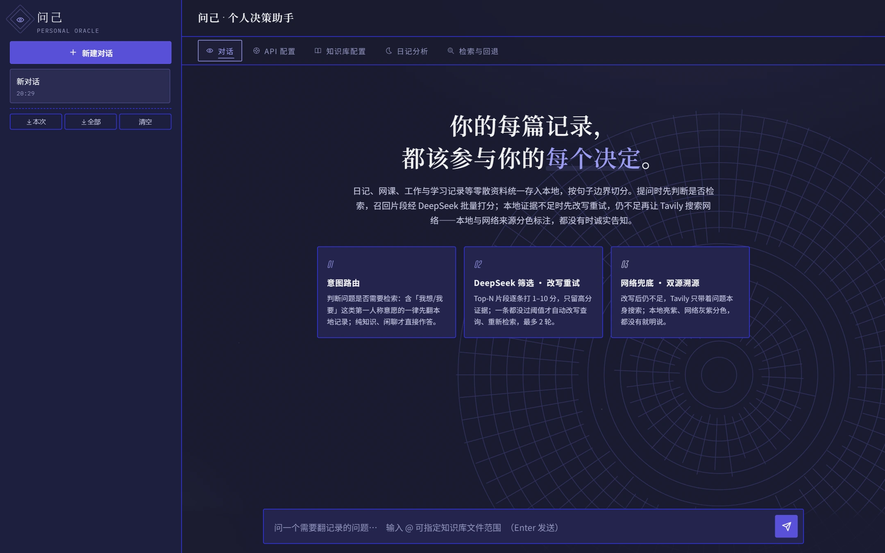
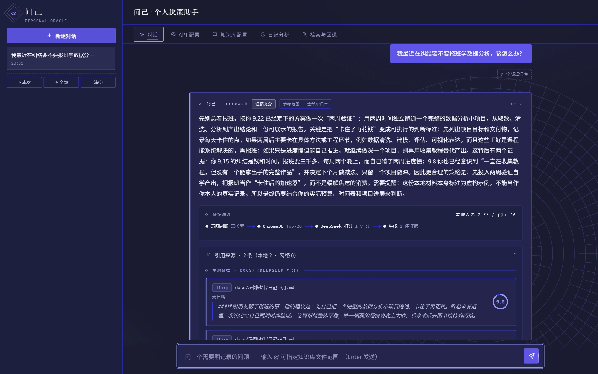
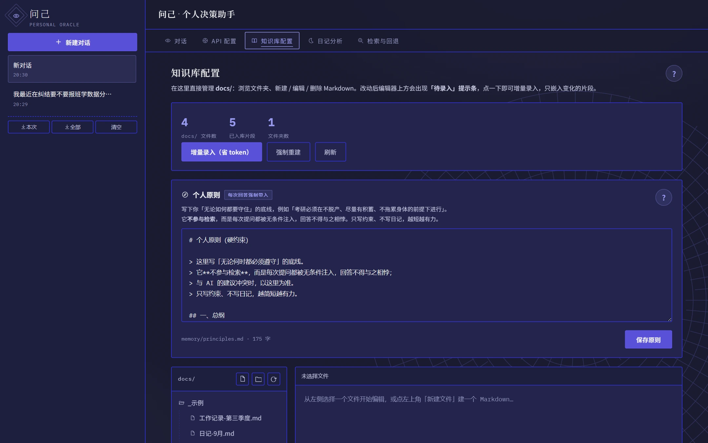
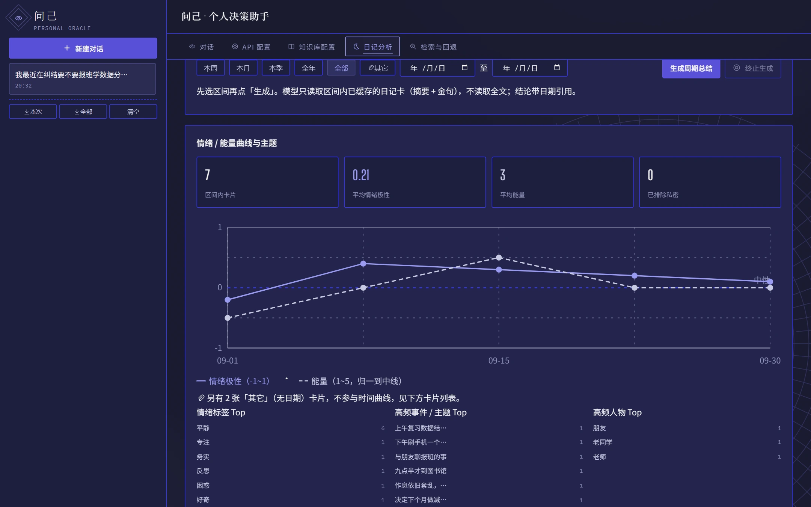
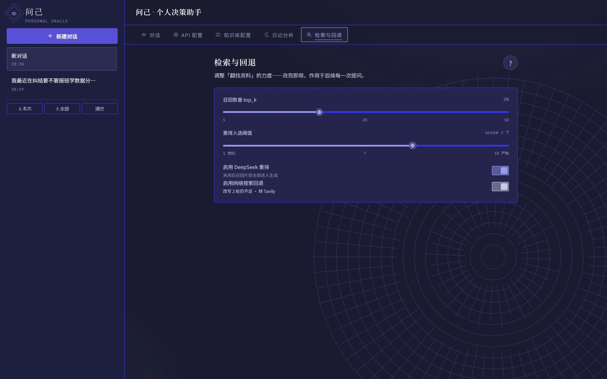
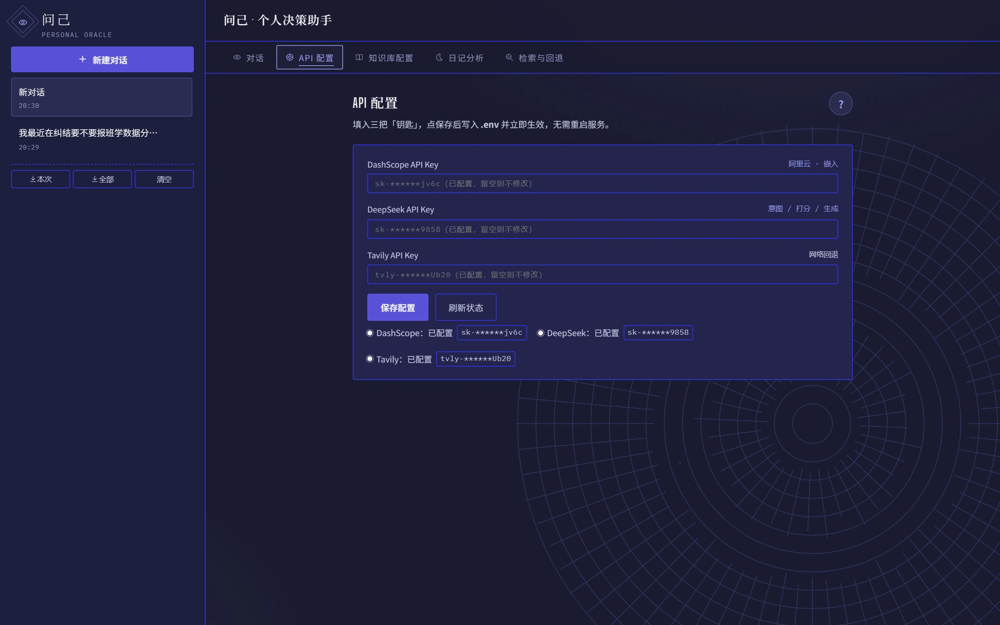
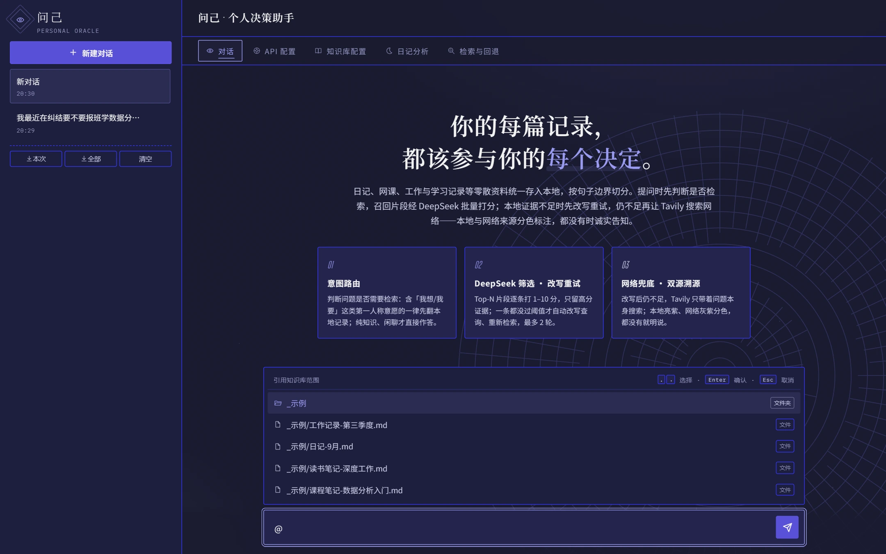
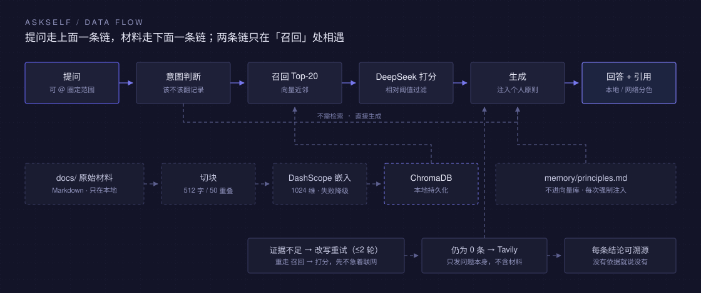

<div align="center">

# 问己 AskSelf

**把你的日记、笔记、聊天记录，变成一个会引用出处的私人参谋。**

不联网也能答，答不上来会直说，每句话都能点回原文。




</div>

---

## 这是什么

一个**跑在你自己电脑上**的个人知识库问答系统。它把你散落各处的 Markdown（日记、网课笔记、工作记录、聊天存档、收藏文章）统一切成片段存进本地向量库；你提问时，它先判断「这问题该不该翻记录」，再去翻，翻到的每一段都要经过一次打分筛选，最后生成**带引用来源**的回答。

它解决的不是「能不能聊」，而是三个更实际的问题：

| 普通大模型 | 问己 AskSelf |
|---|---|
| 不知道你的过去，只能给通用建议 | 结论来自你自己的记录，会指出「你在 9.22 说过……」 |
| 换个话题就忘了你是谁 | 你的材料常驻本地库，越攒越准 |
| 说的对不对你无法核实 | 每条结论带引用，点开就是原文片段 |
| 聊天内容全进了别人的服务器 | 原始文件和索引不出本机；敏感片段可标记为不入索引 |

核心取向只有一条：**模型能力可以租，数据主权不能让。**

---

## 技术栈

| 层 | 用了什么 | 具体用法 |
|---|---|---|
| 运行时 | Python 3.10+ | 全量类型标注，业务模块统一从 `src/config.py` 取配置 |
| Web 服务 | FastAPI 0.115+ · Starlette · Uvicorn | 单端口同时托管 REST API 与前端页面；`uvicorn` 在 `main()` 内按需启动 |
| 参数校验 | Pydantic v2 | `/api/chat` 请求体字段白名单 + 取值范围约束 |
| 工作流 | LangGraph 0.2+ | `StateGraph` 串起 意图判断 → 召回 → 重排 → 改写 → 生成 → 兜底 |
| 切块 | langchain-text-splitters | `RecursiveCharacterTextSplitter`，512 字 / 50 重叠 / 句末分隔符优先 |
| 向量库 | ChromaDB 1.x | `PersistentClient` 落盘 `chroma_db/`；写入与查询都显式传向量，不启用内置 ONNX 模型 |
| 嵌入 | DashScope（阿里云百炼）· OpenAI 兼容协议 | `qwen3.7-text-embedding` → `-flash` 逐级降级；1024 维，维度记录在 `chroma_db/embedding_model.txt` 用于对齐 |
| 生成 / 打分 | DeepSeek `deepseek-chat` | 一次调用批量给 Top-K 打分，`response_format=json_object` + `temperature=0` |
| 网络兜底 | Tavily | 仅当本地证据为 0 时触发，只发问题文本 |
| 配置解析 | python-dotenv · PyYAML | `.env` 单一配置源；材料 frontmatter 用 PyYAML 解析 |
| 前端 | 原生 HTML + CSS + JavaScript，**单文件** | `frontend/index.html`；零框架、零构建、零 npm；图标为内联 SVG `<symbol>`，蚀刻底图为内联 SVG data-URI |
| 前端字体 | Google Fonts | Big Shoulders Display（标题）· IBM Plex Mono（数字/代码）· Noto Sans SC（正文）· Noto Serif SC（引文） |
| 本地存储 | SQLite（Chroma 内嵌）· JSONL · Markdown | 向量与元数据在 `chroma_db/`；聊天记录按月追加 `chat_history/YYYY-MM.jsonl`；周期总结落 `reports/` |
| 打包 | PyInstaller | `build_exe.py` 生成 onedir（推荐）/ onefile；程序与数据目录分离 |

三条明确的取舍：

- **模型全走 OpenAI 兼容协议**：换供应商只改 `base_url` 和模型名，不动业务代码。
- **前端不做工程化**：没有 node_modules、没有构建产物、没有版本漂移，`git clone` 完直接能跑；代价是单个 HTML 文件比较长（约 3300 行）。
- **检索链路全本地**：向量库、原始文件、聊天记录都不出机器；但切块后的文本要发给嵌入与生成服务，这是 RAG 的必要环节，自己评估服务商条款。

---

## 界面

单文件前端（`frontend/index.html`），无构建、无框架、无 npm。由后端同一端口托管，打开 `http://127.0.0.1:8000/` 即用。五个页面覆盖全流程：

### 对话：回答 + 证据链

提问后可以看到完整的推理路径（意图判断 → 召回 → 打分 → 生成），以及每条引用的打分。



### 知识库：在浏览器里管 docs/

浏览目录、新建文件夹、新建 / 编辑 / 删除 Markdown，改完点一下「增量录入」即可进索引，不用开资源管理器。



### 日记分析：从记录里看出趋势

把记录切成一天一条，生成结构化「日记卡」（摘要、情绪、能量、主题、意图、待办、金句），再聚合成情绪/能量曲线与主题排行。



### 检索与回退：动手调参数

召回数量、打分阈值、是否启用重排、是否允许联网，改完即对下一次提问生效。



### API 配置：Key 只写在本机 `.env`

三个 Key 在这里填，页面上永远只显示掩码（`sk-******9f3a`），不会回传明文。



### `@` 圈定检索范围

输入框敲 `@` 弹出知识库目录树，选中后本次提问只在这些文件/文件夹里找，并且**不触发网络回退**——答案必须来自你圈定的那几篇。



---

## 它怎么工作



几个刻意为之的设计：

- **意图判断优先**：纯数学、纯代码、纯寒暄、常识性定义不检索，直接答。判定规则里有一条硬约束——**只要出现第一人称意愿（我想 / 我要 / 我打算 / 我该不该 / 我犹豫），无论话题多通用，一律先翻记录**。因为「我想买台二手相机要注意什么」这种问题，答案恰恰藏在你的旧笔记里。
- **打分筛选用相对阈值**：不在固定分数上硬卡。有效阈值 = `min(7, max(6, 最高分 - 2))`，有一条够高就按它往下让 2 分收人。个人笔记常是零散一句话，绝对阈值会把它们全丢掉，表现为「明明库里有却说没有」。
- **改写优先，搜索兜底**：证据不足时先改写问题重试（最多 2 轮），还不行才查网。查网只发送**问题文本本身**，不带任何日记内容。
- **原则常驻**：`memory/principles.md` 里的底线不进向量库，而是每次生成时无条件注入 system prompt 顶部——它是约束，不是证据。
- **能说不知道**：证据为 0 且不允许联网时，它会直接告诉你没有依据，不编。

---

## 快速开始

现在的 AI IDE（Codex、DSH、Trae、WorkBuddy之类） 都非常强大，所以可以直接对 AI 说 “请帮我把这个项目跑起来” 即可~甚至可以自己对这个项目做改造

### 环境要求

- Python **3.10+**
- 三个 API Key（前两个必需）：

| Key | 用途 | 去哪申请 | 大概成本 |
|---|---|---|---|
| `DASHSCOPE_API_KEY` | 文本嵌入（向量化） | [阿里云百炼](https://bailian.console.aliyun.com/) | 有免费额度 |
| `DEEPSEEK_API_KEY` | 生成 / 意图判断 / 查询改写 / 证据打分 | [DeepSeek 开放平台](https://platform.deepseek.com/) | 按量计费，很便宜 |
| `TAVILY_API_KEY` | 网络搜索回退（**可选**） | [Tavily](https://tavily.com/) | 有免费额度 |

不填 Tavily 也能跑：在「检索与回退」页关掉「启用网络搜索回退」即可。

### 四步跑起来

以下命令在**仓库根目录**执行。Windows 用 cmd / PowerShell，macOS / Linux 用右侧那列。

**1. 建虚拟环境并装依赖**

```bat
python -m venv .venv
.venv\Scripts\python.exe -m pip install -r requirements.txt
```

```bash
python3 -m venv .venv
.venv/bin/python -m pip install -r requirements.txt
```

**2. 复制配置模板**

```bat
copy .env.example .env
```

```bash
cp .env.example .env
```

打开 `.env`，把三个 Key 填进去（也可以先跳过，启动后在网页「API 配置」页填，效果一样）。

**3. 建索引**

```bat
.venv\Scripts\python.exe src\ingest.py
```

```bash
.venv/bin/python src/ingest.py
```

仓库自带 `docs/示例材料/`（4 个虚构文件），所以这一步**不用准备任何材料就能成功**，先跑通再说。

**4. 启动**

```bat
.venv\Scripts\python.exe src\api.py
```

```bash
.venv/bin/python src/api.py
```

浏览器打开 <http://127.0.0.1:8000/>。端口被占用会自动顺延，换端口也可以：`src/api.py --port 8800`。

如果第 1 次提问就有回答、下面带着「引用来源」卡片，说明整条链路通了。

> 想确认每一步是否正常，可以单独跑检索自测：
> `.venv\Scripts\python.exe src\retrieve.py "我最近在纠结什么"`

### 换成你自己的材料

1. 删掉 `docs/示例材料/`（或者留着当格式参考）。
2. 把你的 `.md` / `.markdown` / `.txt` 丢进 `docs/`，可以建子文件夹分类。
3. 网页「知识库配置」页点 **增量录入**，或命令行跑 `src\ingest.py --incremental`。

也可以完全不开文件管理器——在「知识库配置」页直接新建文件夹、新建文件、粘贴内容、保存、录入。

### 第一次跑可能会遇到的三个坑

- **`ModuleNotFoundError: No module named 'fastapi'`**：装依赖和跑程序用的不是同一个解释器。上面命令里的写法就是让两者一定是同一个（都指向 `.venv`）。
- **`unrecognized arguments: # ...`**：命令末尾带了 `#` 注释。`#` 只在 bash 里是注释，在 cmd / PowerShell 会被当成参数。
- **嵌入报 `Free quota exhausted`**：某个嵌入模型额度用尽。`src/embedding.py` 会自动降级到 `DASHSCOPE_EMBED_MODELS` 里的下一个模型；若降级到的模型维度不同，删掉 `chroma_db/` 重新建库即可。

---

## 目录结构

```
ask-self/
├── frontend/
│   └── index.html          # 前端全部（单文件：HTML + CSS + JS），由 api.py 托管
├── src/
│   ├── config.py           # 唯一配置源：路径、模型、参数、Key
│   ├── embedding.py        # DashScope 嵌入封装（多模型失败降级）
│   ├── ingest.py           # 解析 + 切块 + 嵌入 + 入库（支持增量）
│   ├── retrieve.py         # 检索（可带 sources 范围过滤），也可命令行自测
│   ├── deepseek_rerank.py  # 证据批量打分 + 相对阈值过滤
│   ├── principles.py       # 个人原则读写（不进向量库）
│   ├── web_search.py       # Tavily 网络回退
│   ├── agent.py            # LangGraph 工作流 + run_agent 唯一入口
│   ├── diary_analysis.py   # 记录切分 + 日记卡生成 + 指纹缓存 + 周期聚合
│   ├── chat_store.py       # 聊天记录 JSONL（按月追加）
│   ├── export.py           # 材料 / 聊天导出
│   └── api.py              # FastAPI 包装层，同时托管前端
├── docs/                   # 你的材料（默认不入库，只有示例材料被跟踪）
│   └── 示例材料/           # 虚构示例，可直接删除
├── memory/
│   └── principles.example.md  # 个人原则模板，复制为 principles.md 使用
├── assets/                 # README 用的截图与架构图
├── .env.example            # 配置模板（无密钥）
├── build_exe.py            # 一键打包 Windows exe
├── requirements.txt
└── .gitignore              # 已排除 .env / docs 个人材料 / chroma_db / 各类运行产物
```

运行时才会生成（都不进仓库）：`chroma_db/`（向量库）、`memory/principles.md`、`analysis_cache/`、`reports/`、`exports/`、`chat_history/`。

---

## 材料怎么组织

分类靠**文件名前缀**或 YAML frontmatter 推断，不符合约定也能入库（默认类型 `docs`）。

| 前缀 | 类型 | 例子 |
|---|---|---|
| `diary-` | 日记 | `diary-2026-08-15.md` |
| `course-` | 网课笔记 | `course-ml-ch3.md` |
| `work-` | 工作记录 | `work-2026-Q3.md` |
| `study-` | 学习记录 | `study-notes-007.md` |

frontmatter 可以覆盖前缀，还能标私密：

```markdown
---
type: diary
date: 2026-08-15
tags: [情绪, 工作]
private: true
---
```

`private: true` 的片段在检索阶段就被过滤掉——不是答完再遮，是根本不会进上下文。

**日记合集**支持一份文件写一个月：用裸日期标题（`## 9.15`、`9.6`、`2026-08-15`、`8月24日`）分天即可，分析时会按天切开。

---

## 个人原则（硬约束）

把你的底线写进 `memory/principles.md`，AI 每次回答都会**无条件带上**，不得违背。它和知识库走两条完全不同的路：

| | 知识库 `docs/` | 个人原则 `memory/principles.md` |
|---|---|---|
| 触发 | 意图判断 + 相似度检索，**命中才用** | **每次提问都强制注入** |
| 作用 | 提供事实依据，可被引用 | 约束回答方向，不被引用 |
| 冲突 | — | 以原则为准，并指出冲突 |

因为不进向量库，原则不会混进证据列表被当成"日记片段"引用。

先复制模板：

```bat
copy memory\principles.example.md memory\principles.md
```

```bash
cp memory/principles.example.md memory/principles.md
```

然后在网页「知识库配置」页顶部的原则卡片里直接编辑，保存后**下一次提问立即生效**，不用重启、不用重建索引。

写法建议：只写约束、一句话一条、越短越有力。

---

## 隐私边界

| 数据 | 存在哪 | 会不会发给 API |
|---|---|---|
| 原始 Markdown | 本地磁盘 | 不会 |
| ChromaDB 向量索引 | 本地磁盘 | 不会 |
| 切块后的文本片段 | 本地内存 | 会（嵌入 + 生成需要） |
| 你的提问 | 本地内存 | 会（嵌入 / 生成 / 联网） |
| `memory/principles.md` | 本地磁盘 | 会，随生成请求发给 DeepSeek |
| 网络搜索内容 | 不落盘 | 只发出问题本身 |

哪些东西默认**不进 Git** 已经写死在 `.gitignore`：`.env`、`docs/` 下除示例材料外的一切、`chroma_db/`、`memory/*.md`、`analysis_cache/`、`reports/`、`exports/`、`chat_history/`、`screenshots/`、`dist/`。

> 那为什么 README 里的截图不用 `.gitignore` 掉？因为它们是**用仓库自带的虚构示例材料**现跑现截的，内容本身可公开；截图源文件放在 `assets/` 并纳入版本控制，自己另截的图扔 `screenshots/`（已忽略）。

如果你要 fork 后公开发布，动手前先自查一遍：

```bash
git status --porcelain | findstr /i "env chroma principles chat_history"
```

没有输出就干净。

---

## 本地 API

默认绑定 `127.0.0.1:8000`，一个端口同时提供页面和接口。完整交互文档在 `/api/docs`。

| 方法 | 路径 | 说明 |
|---|---|---|
| `GET` | `/` | 前端页面 |
| `GET` | `/api/health` | 探活 + 三个 Key 是否已配置（不返回内容） |
| `POST` | `/api/chat` | 问答，字段与 `run_agent` 一一对应 |
| `GET` `POST` | `/api/config` | 查询 / 保存 Key（写回 `.env` 并热更新） |
| `GET` | `/api/kb` | 文件数 / 片段数 / 文件清单 |
| `GET` `POST` | `/api/kb/tree` `/api/kb/file` `/api/kb/mkdir` `/api/kb/delete` | docs/ 内的文件管理（服务端做越界校验） |
| `GET` `POST` | `/api/principles` | 读写个人原则 |
| `POST` | `/api/ingest` | `mode=incremental`（默认）/ `mode=rebuild` |
| `GET` `POST` | `/api/analysis/status` `/api/analysis/generate` `/api/analysis/cancel` `/api/analysis/cards` `/api/analysis/summary` | 日记分析全流程 |
| `POST` | `/api/export/diary` `/api/export/chat` | 导出（ZIP / 合并 Markdown / JSON / CSV） |
| `GET` `POST` | `/api/chat/history` `/api/chat/history/clear` | 聊天记录读取 / 物理清空 |

请求体示例：

```json
{
  "question": "我最近在纠结什么？",
  "history": [],
  "top_k": 20,
  "jev_threshold": 7,
  "use_jev": true,
  "use_web_search": true,
  "sources": null,
  "conversation_id": null
}
```

`sources` 传数组即等价于在输入框里 `@` 圈范围：**非空就强制检索、只在范围内查、不回退网络**。

---

## 增量录入

「知识库配置」页的 **增量录入**（命令行 `src/ingest.py --incremental`）按**片段正文的 SHA1 指纹**去重：

| 你的操作 | 系统行为 |
|---|---|
| 新增一段 | 只重嵌那一段所在片段 |
| 改一句话 | 重嵌受影响片段（因有 50 字重叠，通常连带相邻一个） |
| 删一段 | 该片段从库里清除 |
| 只改文件名 | 全部复用旧向量，零嵌入调用（source 元数据会更新） |
| 只改标点 / 空格 | 也算变化，该片段重嵌 |

内容没变时**一次嵌入 API 都不会发**。旁边的「强制重建」才是清库重来——只在换嵌入模型或索引损坏时用。

---

## 日记分析

范围是 `docs/` 下**所有**文件，不是只认日记：

- `type: diary` / 放在 `docs/diary/` 下 / 文件名 `diary-` 开头 → 视为合集日记，**按天切分**；
- 其他文件（聊天记录、笔记、文章、清单）→ **整篇一条记录**，日期取 frontmatter 或文件名，没有日期就归到「其它」。

每条记录一次 DeepSeek 调用，产出结构化日记卡：3–5 句摘要、关键事件、涉及的人、地点、情绪极性（-1~1）、能量（1~5）、情绪标签、意图、待办、金句、与个人原则的冲突标记。

- 缓存键 = 正文 SHA1 + prompt 版本，正文没改就不重算（缓存在 `analysis_cache/`）；
- 模型失败会重试一次，仍失败则降级为「正则 + 情绪词典」（卡片标「降级」）；
- 「终止生成」按钮常驻，随时中断，已生成的卡片不丢；
- 周期总结只读卡片的摘要和金句（**不读全文**），每 20 条分块汇总再合并，报告落到 `reports/`。

命令行自测：`src/diary_analysis.py --scan`、`--generate --limit 4`。

---

## 打包成 Windows exe

给没有 Python 的电脑用：

```bat
.venv\Scripts\python.exe build_exe.py
.venv\Scripts\python.exe build_exe.py --onefile
```

产物 `dist\AskSelf\AskSelf.exe`（文件夹版，整个 `dist/AskSelf` 一起拷走）或 `dist\AskSelf.exe`（单文件版）。

双击自动起服务并开浏览器，端口被占自动顺延。两个关键点：

1. **程序和数据是分开的**：`frontend/`、`.env.example` 打进程序；`docs/`、`chroma_db/`、`memory/`、`.env` 在 **exe 同级目录**首次运行时创建。单文件版每次运行会解压到临时目录、退出即清空，日记和向量库绝不能放进去。
2. **可以排除 `onnxruntime`**（省上百 MB）：因为写入和查询**总是显式传向量**，ChromaDB 自带的 ONNX 嵌入模型永远不会被调用。若将来改成不传向量，记得把它加回来。

---

## 常见问题

**Q：它和直接在 ChatGPT / DeepSeek 网页版里问有什么区别？**
A：区别在证据。网页版不知道你 9 月 22 日写过什么；这里的每条结论都能点回你的原文片段。它不会替你编一段"你的过去"。

**Q：能不能不用 DeepSeek？**
A：生成、意图判断、查询改写、证据打分都走 OpenAI 兼容接口，改 `config.py` 里的 `DEEPSEEK_BASE_URL` 和模型名即可指向别的兼容服务。嵌入必须是 DashScope 系（维度要对得上）。

**Q：一定要联网吗？**
A：不是。网络回退可以关掉；但嵌入和生成本身要调 API（本项目的取舍是"模型租用、数据自持"）。想要全离线，得把嵌入和生成都换成本地模型——接口都在 `embedding.py` / `deepseek_rerank.py` 里，换起来不难。

**Q：库里明明有，它却说没有？**
A：按顺序查三层：① 意图判断是不是误判成"不需要检索"（最常见）；② 索引里有没有当前文件（换过 `docs/` 必须重跑 ingest）；③ 打分是不是把分数打下去了（同一片段打分会有 ±1 抖动，属正常）。`src/retrieve.py` 加 `--source` 可以绕开 agent 单独验证召回。

**Q：`chroma_db/` 能删吗？**
A：能，它就是缓存。删了重跑 `src/ingest.py` 即可（会重新花一次嵌入费用）。

**Q：为什么前端只有一个 HTML？**
A：刻意的。没有构建步骤、没有 node_modules、没有版本漂移，`git clone` 完直接能跑。改样式改的就是那个文件。

---

## 声明

- `docs/示例材料/` 下所有内容均为**虚构**，用于演示功能，与任何真实人物无关。
- 仓库不含任何个人材料、聊天记录、API Key 或向量索引。
- 使用本项目即表示你了解：你的材料会被切块后发送给嵌入服务与生成服务（这是 RAG 的必需环节），请自行确认这些服务商的数据条款符合你的要求。
